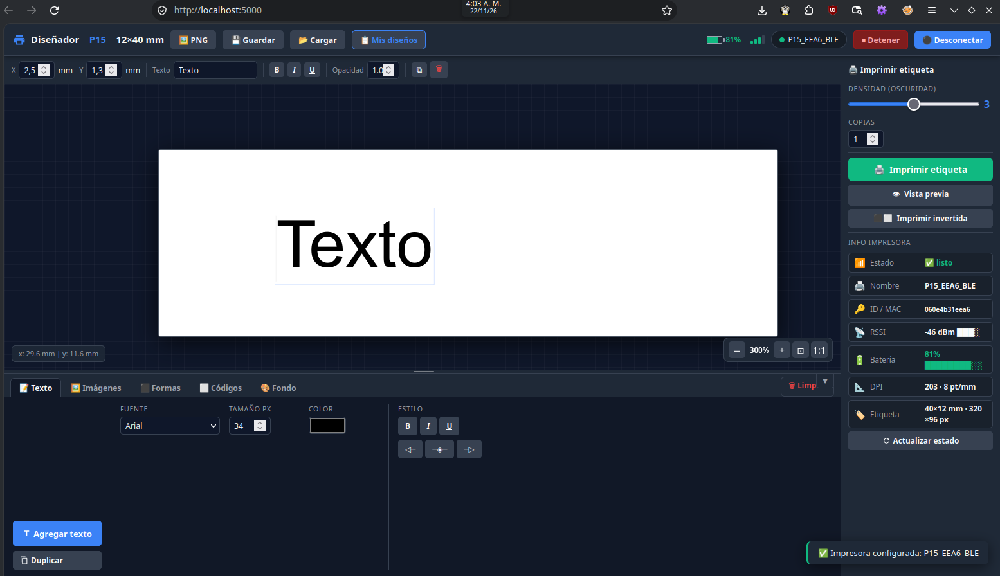

# P15 Designer

Editor visual de etiquetas de 40 × 12 mm para impresoras térmicas **Marklife P15**
(y compatibles con el protocolo L11), con impresión directa por Bluetooth.

La aplicación es un servidor Flask local + una interfaz web. La comunicación BLE
se hace mediante un pequeño puente escrito en TypeScript (`thermoprint_ref/`)
que se ejecuta con [bun](https://bun.sh) y mantiene la conexión con la impresora.

## Interfaz



*Editor visual con panel de impresión, estado de la impresora (batería, RSSI,
DPI) y previsualización de la etiqueta de 40 × 12 mm.*

## Descargas (GitHub Actions)

El repositorio compila automáticamente en
[GitHub Actions](https://github.com/enlinea777/Impresora-P15/actions). Cada push
a `main` genera estos artefactos:

| Plataforma | Archivo |
| --- | --- |
| Linux x86_64 | `P15-Designer-<v>-x86_64.AppImage` |
| Linux x86_64 | `P15-Designer-<v>-linux-x86_64.tar.gz` |
| Linux ARM64 | `P15-Designer-<v>-aarch64.AppImage` |
| Linux ARM64 | `P15-Designer-<v>-linux-aarch64.tar.gz` |
| Windows x64 | `P15-Designer-<v>-windows-x86_64.zip` |
| Windows ARM64 | `P15-Designer-<v>-windows-aarch64.zip` |
| macOS Intel | `P15-Designer-<v>-macos-x86_64.zip` |
| macOS Apple Silicon | `P15-Designer-<v>-macos-aarch64.zip` |
| Flatpak (Linux x86_64) | `P15-Designer-<v>-x86_64.flatpak` |

Al crear un tag `v1.0.0` se publica además un **GitHub Release** con todos los
archivos y sus checksums.

> Windows ARM64: el addon de `noble` no publica binario para `win32-arm64`; el
> workflow lo compila con Visual Studio en el runner ARM64. macOS y Windows x64
> usan binarios precompilados.

## Linux — AppImage (recomendado)

El AppImage incluye **todo**: Python, dependencias de Python, bun, las
dependencias Node y el código de thermoprint. No hace falta instalar nada.

```bash
./packaging/build_appimage.sh
```

Genera:

```
dist/P15-Designer-1.0.0-x86_64.AppImage
```

Ejecutar:

```bash
./dist/P15-Designer-1.0.0-x86_64.AppImage
```

Se abre el navegador y queda un ícono en la bandeja del sistema. Opciones:

```bash
AppImage --no-tray              # solo servidor web
AppImage --no-browser           # no abrir el navegador
AppImage --port 5001            # otro puerto HTTP
AppImage --setup-bluetooth      # conceder permisos BLE (una vez)
AppImage --help
```

## Windows y macOS — paquete portable

Se compilan en el sistema destino (o en CI) con:

```bash
python packaging/build_bundle.py
```

- **Windows:** descomprime el ZIP y ejecuta `P15-Designer.vbs` (sin consola) o
  `P15-Designer.bat` (con consola, útil para depurar). Los datos y el log van a
  `%APPDATA%\P15-Designer`.
- **macOS:** descomprime el ZIP y abre `P15 Designer.app`. La app está firmada
  solo de forma ad-hoc: si Gatekeeper la bloquea, usa clic derecho → Abrir (o
  `xattr -dr com.apple.quarantine "P15 Designer.app"`). Los datos van a
  `~/Library/Application Support/P15-Designer`.

El paquete portable de Linux (`tar.gz`) funciona igual que el AppImage pero sin
integración de escritorio:

```bash
tar -xzf P15-Designer-1.0.0-linux-x86_64.tar.gz
cd P15-Designer
./P15-Designer
```

## Flatpak / Flathub

El workflow también genera un `.flatpak` instalable. El manifiesto y las
instrucciones para enviarlo a Flathub están en
[`packaging/flatpak/README.md`](packaging/flatpak/README.md).

**Limitación:** el sandbox de Flatpak no concede `CAP_NET_RAW`, que `noble`
necesita para los sockets HCI. El diseño, la previsualización y la exportación
funcionan; para imprimir por BLE usa el AppImage o el tar.gz con permisos sobre
bun. Ver el README de Flatpak.

### Permisos Bluetooth en Linux

Para escanear/conectar por BLE sin ser root, bun necesita las capacidades
`cap_net_raw` y `cap_net_admin`. Dentro del AppImage el binario está en una
imagen de solo lectura y no puede conservar *file capabilities*, por lo que en
el primer uso hay que:

1. Pulsar **«Permitir Bluetooth»** en la cabecera de la app (pide contraseña
   mediante `pkexec`), o
2. ejecutar una vez `AppImage --setup-bluetooth`, o
3. hacerlo a mano:

```bash
mkdir -p ~/.local/share/p15-designer/bin
cp <ruta-al-AppImage-extract>/usr/lib/p15/thermoprint/bun ~/.local/share/p15-designer/bin/
sudo setcap cap_net_raw,cap_net_admin+eip ~/.local/share/p15-designer/bin/bun
```

La app copia bun automáticamente al pulsar el botón; solo hace falta `sudo` o
`pkexec` y `libcap2-bin` (`setcap`/`getcap`).

### Requisitos del AppImage

- Linux x86_64 (también se puede compilar para aarch64).
- glibc ≥ 2.27 aproximadamente (requisito de bun).
- BlueZ y un adaptador Bluetooth que funcione con HCI.
- Escritorio con bandeja del sistema (si no, arranca en modo navegador).

## Desarrollo (sin AppImage)

```bash
./run.sh                 # crea venv e instala requirements.txt
```

Requiere `bun` en el `PATH` (o `BUN_BIN=/ruta/a/bun`) y las dependencias Node de
thermoprint:

```bash
cd thermoprint_ref
bun install --production --filter '@thermoprint/cli'
cd ..
./venv/bin/python app.py
```

Para la bandeja del sistema:

```bash
./venv/bin/python tray_app.py
```

## Estructura

```
app.py                     Servidor Flask y API HTTP
printer.py                 Puente Python → bun/ble_server.ts
tray_app.py                Lanzador con bandeja del sistema
templates/index.html       Interfaz web (editor de etiquetas)
static/                    Recursos estáticos
thermoprint_ref/           Código vendorizado de thermoprint + ble_server.ts
packaging/                 Scripts de AppImage, bundle portable y Flatpak
packaging/build_bundle.py  Paquete portable para Linux/Windows/macOS
packaging/flatpak/         Manifiesto Flatpak/Flathub
.github/workflows/build.yml  CI: 6 targets + Flatpak + release
run.sh                     Lanzador de desarrollo
```

## Datos y logs

- Datos: `~/.local/share/p15-designer/` (o `$XDG_DATA_HOME/p15-designer`).
- Log: `~/.local/share/p15-designer/p15.log`.
- Copia de bun con permisos: `~/.local/share/p15-designer/bin/bun`.
- Los diseños se guardan en el `localStorage` del navegador.

## Variables de entorno

| Variable | Descripción |
| --- | --- |
| `P15_PORT` | Puerto HTTP (defecto 5000) |
| `P15_BLE_PORT` | Puerto del puente BLE (defecto 7315) |
| `P15_DATA_DIR` | Directorio de datos escribible |
| `P15_APP_DIR` | Directorio de recursos (lo define AppRun) |
| `P15_THERMOPRINT_DIR` | Directorio de thermoprint (lo define AppRun) |
| `P15_BUN` / `BUN_BIN` | Binario de bun a usar |
| `P15_SKIP_NODE` | `1` para omitir `bun install` al compilar |

## Licencia

P15 Designer se distribuye bajo **GPL-2.0** (ver `LICENSE`).

El puente BLE y el pipeline de impresión provienen de
[thermoprint](https://github.com/tomLadder/thermoprint) (MIT, compatible con
GPLv2). Ver `THERMOPRINT_UPSTREAM.md` para el commit base y los cambios locales.
